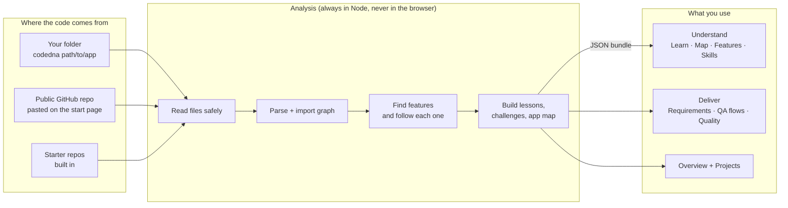
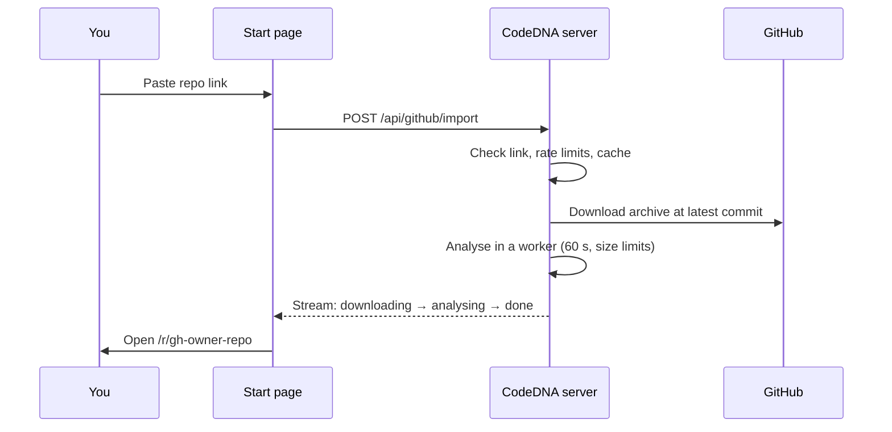
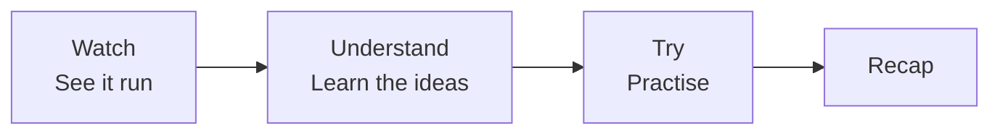
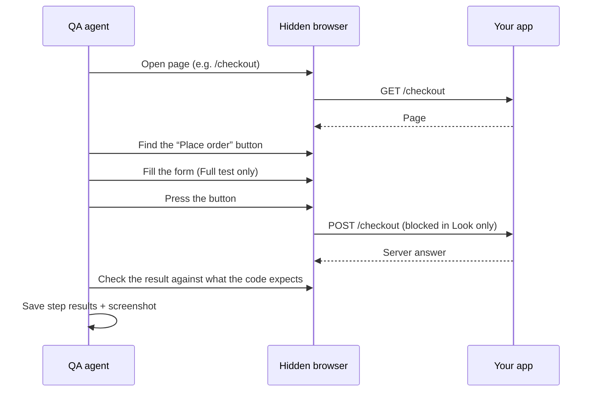
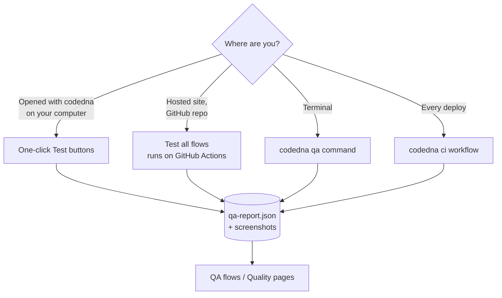
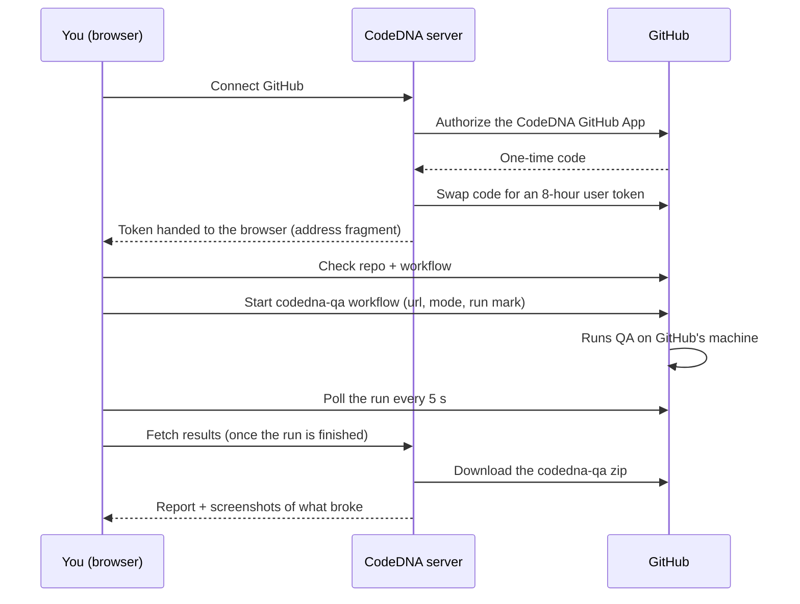

# CodeDNA — Features and How It Works

CodeDNA helps people understand real web apps — including ones an AI wrote for them — and then check that those apps are right. It reads a project's code, finds every feature (a button, a form, a link) and follows it step by step to the server and back. From that it builds:

- **Lessons**: animated feature stories and hands-on challenges, made only from the real code.
- **Delivery checks**: how much of a requirements document is built, where the code could break, and a QA agent that tries every user flow in a real browser.

Anything CodeDNA can't follow in the code is shown as an **unknown part**. It is never guessed or invented.

---

## Contents

1. [The big picture](#1-the-big-picture)
2. [Ways to open a project](#2-ways-to-open-a-project)
3. [How a project is analysed](#3-how-a-project-is-analysed)
4. [Pages and features](#4-pages-and-features)
5. [The QA agent](#5-the-qa-agent)
6. [Running QA: the four ways](#6-running-qa-the-four-ways)
7. [Command line reference](#7-command-line-reference)
8. [Safety and privacy rules](#8-safety-and-privacy-rules)
9. [Settings (environment variables)](#9-settings-environment-variables)
10. [Project structure](#10-project-structure)
11. [Limits and what's not built yet](#11-limits-and-whats-not-built-yet)
12. [Checks](#12-checks)

---

## 1. The big picture



**Analysis runs in Node.** It runs in the CLI on your computer, in a server worker for GitHub imports, or at build time for the starter repos. The browser only ever receives a JSON **bundle** (the analysis plus the learning plan), so the TypeScript compiler is never shipped to the browser. **No code from the project is ever run** during analysis.

---

## 2. Ways to open a project

| Way | How | Address | Where the analysis runs |
| --- | --- | --- | --- |
| **Your own folder** | `pnpm codedna path/to/app` | `http://localhost:3737/r/local-<name>` | On your computer (CLI) |
| **Public GitHub repo** | Paste `https://github.com/owner/repo` on the start page | `/r/gh-<owner>-<repo>` | CodeDNA server, in a worker with limits |
| **Starter repo** | Pick one on the start page or `/explore` | `/r/<starter>` | At build time |

Every project you open is listed on **`/projects`** (kept in this browser only).

### GitHub import flow



Imports are limited to 5 per visitor every 10 minutes, 60 per hour overall and 2 at a time. The same repo imported again within 10 minutes reuses the cached result. If anything goes wrong, the import stops rather than continuing.

---

## 3. How a project is analysed

1. **Read safely.** Only `.js/.jsx/.ts/.tsx` files, `package.json`, `tsconfig`/`jsconfig` and READMEs are read. `.env*` files, `.gitignore`d files, build output, `node_modules` and symlinks are skipped. Size and file-count limits apply.
2. **Parse and resolve.** Each file's syntax is parsed and an import graph is built. TypeScript's type checker resolves calls, re-exports, aliases and methods. Only `baseUrl` and `paths` are read from tsconfig: no plugins, no `extends`, and config files are never `require()`d.
3. **Recognise the framework.** Next.js App Router pages, layouts, route handlers and server actions are recognised.
4. **Find entry points.** Click handlers, form submits, links, and API routes or server actions that nothing in the UI calls.
5. **Follow each feature.** Every entry point is followed through the calls it makes, and each step is placed on the journey: *screen → click → request → server → data → response → screen*. Along the way CodeDNA records:
   - **Effects**: Prisma, Supabase, Drizzle, `fetch`, axios, redirects, cookies, zod validation, auth, email, payments.
   - **Branches**, with the exact condition text from the code.
   - **Unknown parts**, each with a plain reason.
6. **Name and group features in plain language.** Names come from the handler, the data and the page (e.g. "Place order"). Features are grouped into big **sections** (e.g. "Admin" from `/admin/*`), then **areas**. Small details (typing, closing boxes, clearing filters) are folded away.
7. **Rate confidence.** Every step is marked *Sure* (resolved), *Framework rule*, *Likely*, or *Unknown*.
8. **Build the learning plan.** One lesson per main feature, the concepts each step uses, an easy-to-hard learning path, challenges and a one-sentence app summary.

---

## 4. Pages and features

The left rail of every project has three groups: **Project**, **Understand** and **Deliver**.

### Project

#### Overview — `/r/<repo>/overview`
One page for the whole project:
- learning progress;
- requirements coverage;
- risks found in the code;
- the last QA run;
- "what to do next" suggestions (e.g. *Fix 1 failed check*).

#### Projects — `/projects`
Every project opened in this browser, each with its status. You can remove projects from the list.

### Understand

#### Learn (My App) — `/r/<repo>`
Opens with **"How the app is put together"**, then shows the learning path: lessons ordered from easy to hard, with progress.

#### Lessons — `/r/<repo>/learn/<lesson>`
Each lesson follows one real feature through four stages:



- **Watch**: an animated **Feature Story** plays the flow step by step, from the click to the server and back, showing the real code for each step.
- **Understand**: the concepts the feature uses (e.g. *state*, *server action*, *validation*). Each has three parts: the idea, where it appears in your app, and a quick check.
- **Try**: challenges generated from the code. They are deterministic, and unknown steps are never used as answers:
  - **Predict** what happens next
  - **Order the steps**
  - **Spot the bug**
  - **Fill the gap**
- **Recap**: what you learned, plus XP.
- A **Test it** stage appears only when a lesson has test scenarios.

**Progress** (XP, daily streak, mastery and "Updated" lessons after the code changes) is stored in this browser only (IndexedDB), with no telemetry.

#### Map — `/r/<repo>/map`
The **App map**: the app's sections and areas, each with its pages and features, so a newcomer sees the shape of the whole repo at once.

#### Features — `/r/<repo>/features` and `/r/<repo>/story/<feature>`
Every feature, grouped by section and area. Opening one plays its **Feature Story** on its own, outside a lesson.

#### Skills — `/r/<repo>/skills`
A **Skill map** of the concepts in this app and how well you know each one.

The **Concept Card drawer** can be opened from anywhere a concept appears.

### Deliver

#### Requirements — `/r/<repo>/requirements`
1. Drop in an SRS or client brief: **PDF, Word (.docx), text or Markdown**.
2. It is read **in the browser** (pdf.js / mammoth) and never uploaded.
3. Each requirement is matched against the traced features (keywords plus synonyms) and marked **Built**, **Partly built** or **Not found**, with the matching features.
4. The overall coverage % shows on the rail and on the Overview.

The document is kept in this browser.

#### QA flows — `/r/<repo>/qa`
The visual home of the QA agent (details in [section 5](#5-the-qa-agent)). It has two tabs, and the page remembers which one you last used.

- **Test in a browser panel**: your app's address, **Look only** or **Full test**, and the run controls (they depend on where the page is open; see [section 6](#6-running-qa-the-four-ways)).

**User journeys** (the default tab):

- **Counters**: journeys, broke, to look at, not tested yet.
- **Test account**: on your computer, the email and password journeys sign in with (saved in `.codedna`; the password is never shown again). On the hosted site, a note about the `CODEDNA_QA_EMAIL` / `CODEDNA_QA_PASSWORD` secrets.
- **Journey list** grouped by section, with each journey's route (e.g. `/ → /checkout`) and its state.
- **Journey map**: the journey left to right. Each step is a station, and each point is something the browser does:

```
 /          Go to checkout                 Place order
[Open /] ─ [Find]─[Click]─[Sign in…]─[Opens] ─ [Find]─[Fill]─[Press]─[POST /order]─[Server ✖ 500]─[Result]
```

  - Points turn grey (not tested), blue while running, green when they pass and red where they broke.
  - Request points show their HTTP status.
  - Sign-in points appear inside the step that needed them.
- **Point detail**: what happened, the HTTP request (method, address, answer, time), the matching line of code, and the screenshot at that point.
- **Edit journey**: rename it, move steps up and down, remove steps, add any page or feature, or hide the journey. **New journey** makes your own. Edits go to `codedna.journeys.json` (on the hosted site they are kept in the browser, with a button that copies the file).

**Single features**:

- **Counters**: flows to test, broke, to look at, not tested yet. Each one filters the list.
- **Feature list** grouped by part, each with its state: Testing…, Broke, Look at, Passed, Skipped, Not tested, Can't test.
- **Feature detail**: one tab per case (normal, empty, wrong format, very long text, emoji, pressed twice, …). For each case it shows:
  - a **step strip** (open page → find button → fill form → press → request → server answer → result), with the step that broke in red and everything after it grey;
  - **What should happen** and **What happened**;
  - a **step-by-step list** with the matching line of code for each step;
  - the inputs that were typed;
  - the **screenshot** of the page after the last step.

#### Quality — `/r/<repo>/quality`
- **Findings** read from the code (risky patterns, missing checks).
- **Edge cases** taken from the real conditions in the code, as a tick-off checklist.
- **Test runs**: the full QA report by suite (tests, walk, flows), with filters and "What CodeDNA saw" evidence for each check.

---

## 5. The QA agent

The QA agent checks a running app. It runs **only on your computer or on your own GitHub Actions**, never on CodeDNA's servers. It always shows its plan and asks before running anything.

### What it checks (runners)

| Runner | What it does | Sends data? |
| --- | --- | --- |
| **tests** | Runs the project's own `test` script and reads the pass/fail counts (Vitest, Jest, Mocha, node:test). | — |
| **walk** | Opens every traced page in a hidden Chrome or Edge and reports crashes, server errors and console errors. | Never |
| **journeys** | Runs every user journey end to end in one browser session: follows the app's links, signs in with the test account when asked, then does the task. It records the HTTP request, status and time at each point and stops at the first broken one. | Signing in always; anything else only in Full test |
| **flows** | Runs every traced feature as a person would, step by step, with a screenshot. | Only in Full test |

### Look only vs Full test

- **Look only** (default): each flow's page is opened, its button is found, and links are followed. **Every request that would send data is blocked**, even ones the page sends by itself.
- **Full test** (`--interact`): each case is actually run. Forms are filled in properly, then empty, then with wrong formats, very long text and emoji, and the button is also pressed twice. What *should* happen in each case comes from the code: the request it sends, where it redirects, the checks it makes.

### Where results go

- The report is saved to `.codedna/qa-report.json` in the project. Screenshots go in `.codedna/qa/<run>/`, the last 5 runs are kept, and the folder is git-ignored.
- Testing a single flow updates only that flow's results; the rest of the report is kept.
- The report can be loaded on the QA flows and Quality pages: automatically when opened with `codedna`, or from a file, or from a GitHub run.

### How one flow case runs



---

## 6. Running QA: the four ways



### 6.1 One click, on your computer
1. Run `pnpm codedna path/to/app` and open **QA flows**.
2. Enter your app's address (`http://localhost:3000` or a deployed `https://…` site).
3. Choose **Look only** or **Full test**.
4. Press **Test all flows**, or **Test this flow** on a single feature.

The steps fill in **live**, and there is a **Stop** button. A full test shows a warning first. The run happens through the local CodeDNA server, which only answers its own page: it needs a secret token, a same-origin request and a host check, so other websites can't start runs.

### 6.2 One click, on the hosted site (GitHub Actions)
For a GitHub repo opened on the hosted site:



- **Connect GitHub** uses the CodeDNA GitHub App. It can only touch the repo's Actions, and only on repos where the app is installed. Its sign-in lasts 8 hours and is kept in your browser. **Disconnect GitHub** forgets it.
- **Fallback**: paste a fine-grained token limited to the repo with *Actions: Read and write*.
- If the repo doesn't have the workflow yet, the page shows how to add it, with a **Check again** button.
- CodeDNA's server is only used to download the results zip, because GitHub doesn't let browsers do that. The zip is read, never run, and the token is never stored. The server allows 20 downloads per visitor every 10 minutes.

### 6.3 From the terminal
```sh
codedna qa path/to/app                                       # your own tests only
codedna qa path/to/app --url http://localhost:3000            # + walk + flows, look only
codedna qa path/to/app --url https://my-app.vercel.app --only walk,flows --interact
```
The hosted page shows this command with your address filled in. Use `--github owner/repo` so the report loads on that repo's hosted page.

### 6.4 Automatically on every deploy
`codedna ci` adds `.github/workflows/codedna-qa.yml`. After you commit it, GitHub runs QA:
- after every successful deployment (Vercel, Netlify, …), with a **pull-request comment** and a job summary;
- every night, against the `CODEDNA_QA_URL` variable;
- by hand from the Actions tab, or from the hosted page's **Test all flows** button.

It only looks unless `CODEDNA_QA_INTERACT` is `true`. The report and screenshots are kept for 14 days as the `codedna-qa` artifact. Vercel previews behind protection work with the `VERCEL_AUTOMATION_BYPASS_SECRET` secret.

### Testing a deployed site — the ownership rule
- **Look only** is always allowed (https only; nothing is sent).
- **Full test** needs the site owner's agreement. The site must publish `/.well-known/codedna.txt` containing the line:
  ```
  codedna: allow-testing
  ```
  In Next.js, save it as `public/.well-known/codedna.txt`. Without it, nothing is sent and CodeDNA explains what to add.
- Pages of a deployed site are opened more slowly, and the app's own requests carry an `x-codedna-qa: <run>` header so the owner can spot them in their logs.
- Private network addresses and plain `http` are treated as deployed sites for this rule. Public sites must use https.

---

## 7. Command line reference

Not on npm yet: run these from the CodeDNA folder with `pnpm codedna …`.

```text
codedna [folder] [--port <number>] [--no-open]
codedna analyze [folder] [--json | --plan] [--out <file>]
codedna qa [folder] [--url <address>] [--interact] [--only tests,walk,flows] [--yes]
           [--header "Name: value"] [--github owner/repo] [--markdown <file>] [--timeout <s>]
codedna ci [folder] [--force]
```

| Command | What it does |
| --- | --- |
| `codedna` | Analyses the folder and opens the learning UI on `localhost:3737`, with live QA buttons. |
| `codedna analyze` | Prints a summary of features. `--json` prints the full analysis and `--plan` the learning plan; `--out` saves to a file. |
| `codedna qa` | Runs the QA agent (see [section 5](#5-the-qa-agent)). `--yes` skips the question (used in CI). `--header` adds a header for the app only, and can be repeated. |
| `codedna ci` | Writes the GitHub Actions workflow. `--force` overwrites an existing one. |

---

## 8. Safety and privacy rules

| Rule | How it is kept |
| --- | --- |
| Code from a project is never run on CodeDNA's server | Analysis only parses and reads. Repo config files are never `require()`d, and TS plugins are never loaded. |
| Your code stays on your computer | `codedna` reads locally and uploads nothing. The local page answers only on localhost. |
| Nothing runs or acts in your app without a yes | `codedna qa` shows its plan and asks. The Test buttons warn before a full test. |
| QA runs only on your machine or your GitHub Actions | The hosted site never drives a browser. |
| Deployed sites are protected | Look only always; a full test needs `/.well-known/codedna.txt`. Requests are slowed and marked with the `x-codedna-qa` header. |
| No harmful actions | Deleting, paying, transferring and signing out are always skipped. Only made-up test data is typed. |
| Results stay local | Reports and screenshots are kept in `.codedna/` (git-ignored) or in your browser. |
| No tracking | Progress and documents live in your browser. No telemetry without opt-in. |
| GitHub imports fail closed | Size, count, time and rate limits; public repos only. |
| Tokens are handled carefully | GitHub tokens live in the browser. The server uses them for one request and never stores or logs them. |

---

## 9. Settings (environment variables)

None are required to run CodeDNA.

| Setting | Meaning |
| --- | --- |
| `CODEDNA_GITHUB_IMPORT=on` | Allow GitHub imports on a production server. They are always on with `pnpm dev` and the CLI. |
| `GITHUB_TOKEN` | Optional read-only token; raises GitHub's limit from 60 to 5,000 requests an hour. |
| `GITHUB_APP_CLIENT_ID`, `GITHUB_APP_CLIENT_SECRET`, `GITHUB_APP_SLUG` | Turn on **Connect GitHub** on the QA flows page. The GitHub App needs the callback `https://<site>/api/github/auth/callback`, expiring user tokens, no webhook, and only *Actions: Read and write*. |

**Repository variables and secrets for the CI workflow** (in the tested repo):

| Name | Kind | Meaning |
| --- | --- | --- |
| `CODEDNA_QA_URL` | Variable | Site to test every night. |
| `CODEDNA_QA_INTERACT` | Variable | `true` for a full test (the site also needs the ownership file). |
| `CODEDNA_QA_EMAIL`, `CODEDNA_QA_PASSWORD` | Secrets | A test account, so journeys can sign in. |
| `VERCEL_AUTOMATION_BYPASS_SECRET` | Secret | Lets QA through Vercel's preview protection. |

---

## 10. Project structure

A pnpm + Turborepo monorepo (Node 20.19+/22.13+/24+, pnpm 9.15.9).

```text
apps/
  web/        Next.js 15 (App Router, React 19, Tailwind) — the UI and the hosted API routes
  cli/        the codedna command: local server, analyze, qa runners, ci
  vscode/     placeholder for a later phase
packages/
  shared/     versioned contracts: analysis, lessons, QA report, QA targets, CI workflow
  core/       pure engine: snapshot → analysis → learning plan (no fs, network or React)
  node/       Node helpers: safe folder reading, analysis worker with limits
  github/     public GitHub download with limits
  learn-ui/   learning components: story player, concept cards, challenges, progress logic
docs/         architecture, roadmap, this file
```

### Hosted API routes (`apps/web/app/api`)

| Route | Purpose |
| --- | --- |
| `POST /api/github/import` | Import a public repo (streamed progress). |
| `GET /api/github/bundle/<id>` | The bundle of an imported repo. |
| `POST /api/github/qa-results` | Download and read a GitHub QA run's results. |
| `GET /api/github/auth/start` | Start "Connect GitHub". |
| `GET /api/github/auth/callback` | Finish "Connect GitHub". |
| `GET /api/github/auth/config` | Whether "Connect GitHub" is set up. |

### Local API routes (served by the CLI only)

| Route | Purpose |
| --- | --- |
| `/api/local/bundle/<id>` | The bundle of your folder. |
| `/api/local/qa/<id>` | The latest QA report. |
| `/api/local/qa-shot/<id>/<path>` | A screenshot. |
| `GET /api/local/qa-session/<id>` | The page's secret token. |
| `GET` / `POST /api/local/qa-run/<id>` | Run status / start a run (token needed). |
| `POST /api/local/qa-run/<id>/stop` | Stop a run. |

---

## 11. Limits and what's not built yet

**What can be learned**

- Full lessons need a **Next.js App Router** app in JS/TS. Other JS/TS projects are read but may give few lessons.
- Only `.js/.jsx/.ts/.tsx` files are read. Other languages, `.vue`, `.svelte`, `.mjs` and `.cjs` are not.
- Values decided while the app runs are shown as unknown parts.
- Big monorepos and course repos can give repeated or noisy lessons.

**GitHub imports**

- Public repos only, at the latest commit of the default branch.
- Up to 1,000 code files, 2 MB per file and 50 MB in total; 60 seconds to download and 60 seconds to analyse.

**QA agent**

- Pages behind a **sign-in** are reported, not tested.
- Pages with **`[id]`** in the address are skipped.
- Test values are generic, not based on the code's own rules.
- On the hosted site, runs are **all flows at once**. "Test this flow" for a single feature works only on your computer.
- CI builds CodeDNA from `Dishan-dev/codeDNA` on each run (not on npm yet), so that repo must be public.
- Screenshots from GitHub runs: only those of broken and "look at" cases are shown, within a size limit.

**Not built yet**

Generating test files and the full "Test it" stage, the opt-in AI helper, the Explore library, the VS Code extension, and publishing to npm. See [roadmap.md](roadmap.md).

---

## 12. Checks

```sh
pnpm lint && pnpm typecheck && pnpm test && pnpm build
pnpm --filter @codedna/web e2e   # Playwright + axe; first run: pnpm --filter @codedna/web exec playwright install chromium
```
